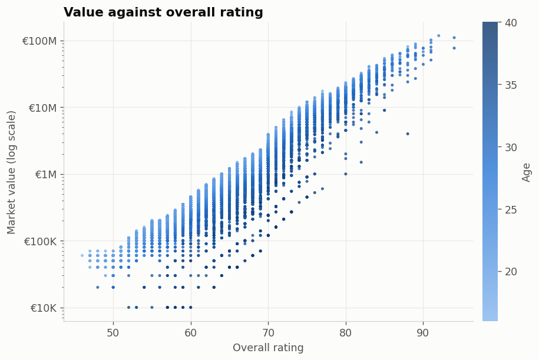
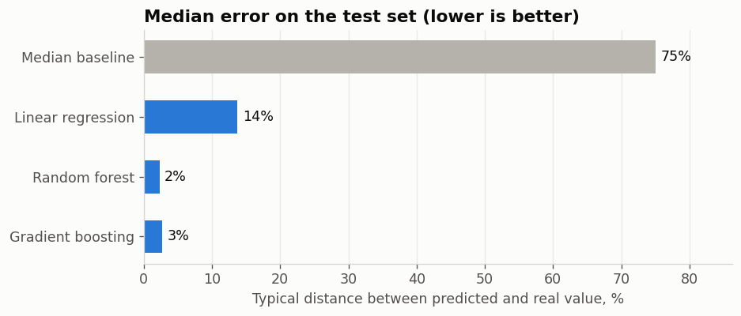

# Python and machine learning labs

My Python lab work, from the language basics to the first machine learning models with scikit-learn, plus a small project that predicts the market value of FIFA 19 players.

## FIFA 19 player value

[`08-fifa-player-value/player_value.ipynb`](08-fifa-player-value/player_value.ipynb) takes 17,907 players from FIFA 19 and tries to predict their market value from age, ratings and attributes.



The value is very skewed (from €10K to €118.5M), so the models predict its logarithm. `Wage` and `Release Clause` are left out because the game derives both from the value, and using them would be data leakage. Each model was scored with 5-fold cross-validation on the training set and then once on a held-out test set of 3,582 players.

| Model | Test R² (log value) | Median error |
|---|---|---|
| Always predict the median | -0.02 | 75% |
| Linear regression | 0.971 | 14% |
| Random forest | 0.997 | 2.3% |
| Gradient boosting | 0.998 | 2.7% |
| Gradient boosting, only overall, potential, age and position | 0.998 | 2.6% |

The last row is the most interesting result. The game computes market value from a handful of the player's own numbers, mostly overall rating, potential and age, and the tree models rediscover that calculation. The 34 individual attributes add nothing once the overall rating is known.



The model's largest misses follow a pattern: highly rated veterans aged 32 to 36 are worth less in the game than predicted, and the most expensive players, such as Messi and De Gea, are worth more, because tree models can't predict beyond the values they saw in training.

## All labs

| Folder | Topic |
|---|---|
| [01-python-basics](01-python-basics) | Notes on types, strings, lists, dictionaries, tuples and sets |
| [02-control-flow](02-control-flow) | Grade checker, number guessing game, lottery draw, positive/negative comment detector |
| [03-functions-and-comprehensions](03-functions-and-comprehensions) | Rock-paper-scissors, `**kwargs`, min-max normalisation, `lambda`/`map`/`filter`, list, set and dict comprehensions |
| [04-numpy-pandas-matplotlib](04-numpy-pandas-matplotlib) | NumPy arrays and matplotlib plots (`main.py`), 16 pandas exercises on the FIFA 19 data (`exercitii.py`) |
| [05-knn-iris](05-knn-iris) | k-nearest neighbours on the Iris flowers: 96.7% test accuracy, choosing k |
| [06-linear-regression-diabetes](06-linear-regression-diabetes) | Simple and multiple linear regression on the diabetes dataset |
| [07-decision-tree-wine](07-decision-tree-wine) | Decision trees on the wine dataset: 96.3% test accuracy, feature importance |
| [08-fifa-player-value](08-fifa-player-value) | The project above |

The notebooks have English explanations between the code cells. The code from the earlier labs keeps its original Romanian comments and messages, and the scripts in 01 to 03 ask for keyboard input.

## Running

The project uses [uv](https://docs.astral.sh/uv/) and Python 3.14. To install the exact versions from `uv.lock`:

```
uv sync
```

Open a notebook in VS Code or PyCharm with the `.venv` interpreter, or run one from the command line and save its outputs:

```
uv run jupyter nbconvert --to notebook --execute --inplace 08-fifa-player-value/player_value.ipynb
```

The FIFA notebook takes about a minute.

## Data

- FIFA 19: the [FIFA 19 complete player dataset](https://www.kaggle.com/datasets/karangadiya/fifa19) from Kaggle, scraped from sofifa.com, in `04-numpy-pandas-matplotlib/data.csv`.
- Iris, diabetes and wine come with scikit-learn.
